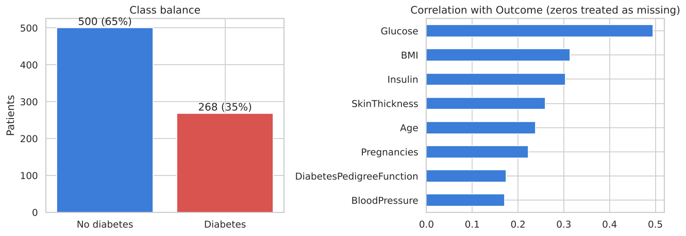
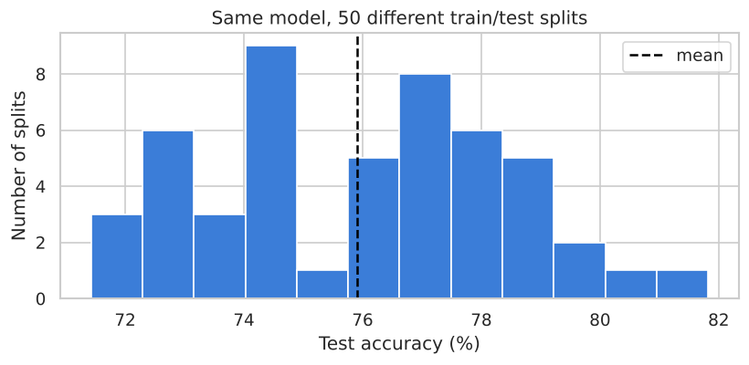
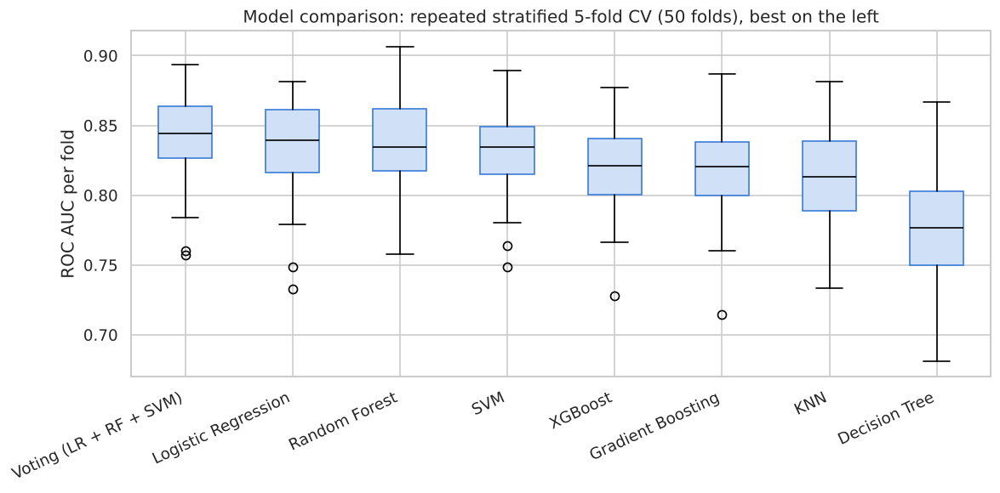
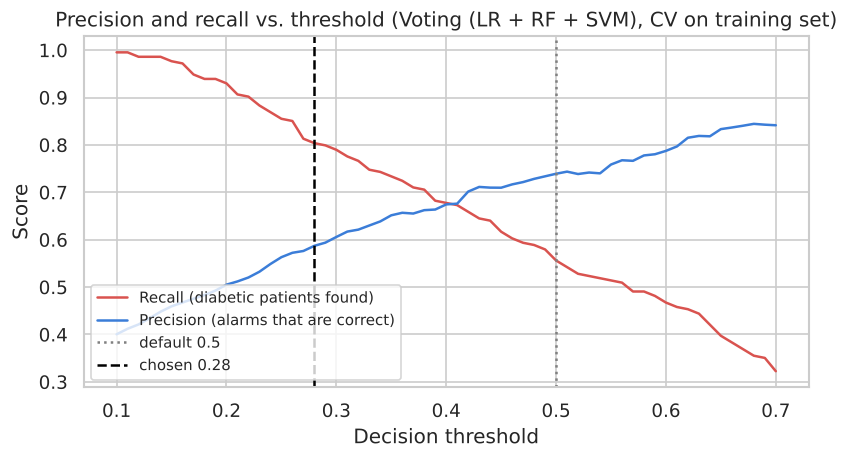
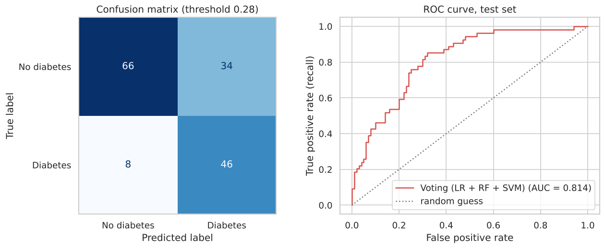
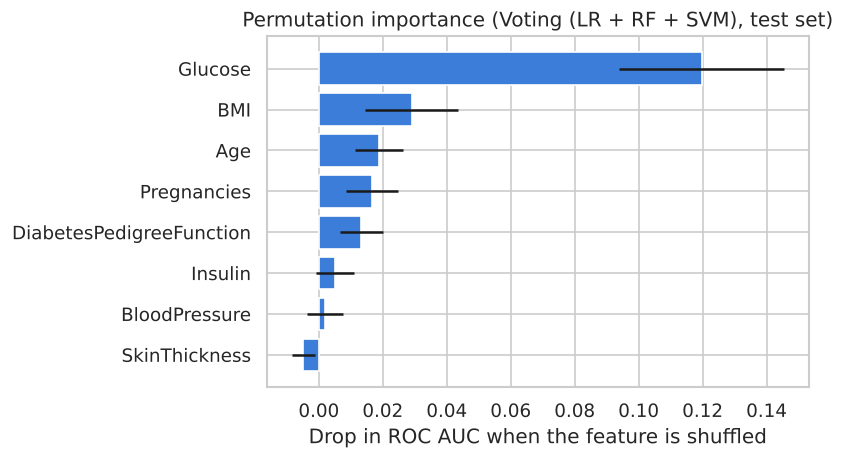

# Predicting Diabetes with Machine Learning

A classification project that predicts whether a patient has diabetes from eight diagnostic measurements, using the Pima Indians Diabetes Database. It compares eight models, but the main focus is on **evaluating them honestly**: finding hidden missing values, avoiding data leakage, measuring how much results depend on the train/test split, and choosing a decision threshold that suits medical screening.

**Skills shown:** data cleaning · scikit-learn pipelines · custom transformers · cross-validation · model comparison · ROC AUC and threshold tuning · permutation importance

---

## Data

[Pima Indians Diabetes Database](https://www.kaggle.com/datasets/uciml/pima-indians-diabetes-database): 768 female patients of Pima Indian heritage, aged 21 and older, from the National Institute of Diabetes and Digestive and Kidney Diseases. 268 of them (35%) have diabetes.

| Feature | Meaning |
|---|---|
| Pregnancies | Number of pregnancies |
| Glucose | Plasma glucose, 2 hours into an oral glucose tolerance test |
| BloodPressure | Diastolic blood pressure (mm Hg) |
| SkinThickness | Triceps skinfold thickness (mm) |
| Insulin | 2-hour serum insulin (µU/ml) |
| BMI | Body mass index |
| DiabetesPedigreeFunction | Score for diabetes in the family history |
| Age | Age in years |

**Hidden missing values.** The data has no empty cells, but five columns contain zeros that are physically impossible, such as a BMI or blood pressure of 0. These are missing measurements:

| Column | Zeros | Share |
|---|---|---|
| Insulin | 374 | 48.7% |
| SkinThickness | 227 | 29.6% |
| BloodPressure | 35 | 4.6% |
| BMI | 11 | 1.4% |
| Glucose | 5 | 0.7% |



## Method

1. **Split first.** 80% of the patients for training, 20% (154) for testing, stratified and with a fixed random seed. The test set is not used for anything until the final evaluation.
2. **Preprocessing inside a pipeline**, so it is learned from the training data only:
   zeros → missing, outlier capping with the IQR rule, median imputation plus a missing-value indicator, standard scaling.
3. **Eight models:** Logistic Regression, Decision Tree, Random Forest, SVM, KNN, Gradient Boosting, XGBoost and a soft-voting ensemble.
4. **Model comparison with repeated stratified 5-fold cross-validation** (10 repetitions = 50 scores per model).
5. **Decision threshold** tuned for screening, then **one final evaluation** on the test set.

## Results

### One train/test split is not enough

The same Random Forest was trained and tested on 50 different random splits:



Accuracy ranged from **71.4% to 81.8%** (mean 75.9%), depending only on which 154 patients ended up in the test set. Differences of a few points between models on a single split are mostly luck, so the models are compared with cross-validation instead.

### Model comparison (cross-validation on the training set)

| Model | Accuracy | Recall | F1 | ROC AUC |
|---|---|---|---|---|
| **Voting (LR + RF + SVM)** | 0.776 ± 0.030 | 0.564 ± 0.073 | 0.635 ± 0.057 | **0.843 ± 0.030** |
| Logistic Regression | 0.784 ± 0.034 | 0.592 ± 0.071 | 0.655 ± 0.058 | 0.838 ± 0.032 |
| Random Forest | 0.767 ± 0.029 | 0.511 ± 0.073 | 0.602 ± 0.060 | 0.836 ± 0.032 |
| SVM | 0.765 ± 0.033 | 0.577 ± 0.071 | 0.630 ± 0.055 | 0.831 ± 0.028 |
| XGBoost | 0.754 ± 0.034 | 0.589 ± 0.077 | 0.623 ± 0.058 | 0.820 ± 0.030 |
| Gradient Boosting | 0.754 ± 0.032 | 0.586 ± 0.076 | 0.622 ± 0.056 | 0.819 ± 0.033 |
| KNN | 0.756 ± 0.029 | 0.515 ± 0.070 | 0.593 ± 0.055 | 0.812 ± 0.035 |
| Decision Tree | 0.731 ± 0.038 | 0.569 ± 0.119 | 0.591 ± 0.067 | 0.773 ± 0.042 |



Most models perform very similarly, and their ranges overlap strongly. A well-preprocessed **Logistic Regression is practically as good as the ensembles**. The voting ensemble has the highest mean ROC AUC and is used as the final model.

### Threshold for screening

With the default threshold of 0.5, the models find only about 50–60% of the diabetic patients (recall column above). For a screening tool, a missed diabetic patient is worse than a false alarm, which a follow-up test can rule out. The threshold was therefore lowered to **0.28**, the highest value that finds at least 80% of diabetic patients in cross-validation on the training set.



### Final evaluation on the test set (154 patients)

| Threshold | Accuracy | Precision | Recall | F1 |
|---|---|---|---|---|
| Default 0.50 | 72.7% | 63.0% | 53.7% | 58.0% |
| **Screening 0.28** | **72.7%** | **57.5%** | **85.2%** | **68.7%** |

ROC AUC on the test set: **0.814**.



With the screening threshold, the model finds **46 of the 54 diabetic patients** (it misses 8), at the cost of 34 false alarms among the 100 non-diabetic patients. Test accuracy is a bit lower than the cross-validation average, which is expected given how much a single split of 154 patients varies (see above).

### Which features matter?



**Glucose** is by far the most important feature, followed by BMI and Age. This matches medical knowledge: blood glucose is what diagnoses diabetes. Insulin and SkinThickness contribute almost nothing, mainly because so many of their values are missing.

## What changed compared with my first version

The first version of this project reported up to **83% accuracy** (Random Forest). Revisiting it, I found several problems that made the results too optimistic or unreliable:

* Missing values were filled and outliers capped on the **whole dataset before splitting**, so information from the test patients leaked into training.
* The split had **no fixed random seed**, so results changed on every run.
* KNN, SVM and Logistic Regression ran **without feature scaling**.
* Models were ranked on **one split of 154 patients**, where (as shown above) chance alone moves accuracy by about 10 points.
* Only accuracy was used, although recall matters most for a screening task.

The corrected numbers are lower, but they are reproducible and give a realistic picture of how the model would perform on new patients.

## Run it yourself

```bash
git clone https://github.com/elmoussaouioumayma/diabetes-prediction.git
cd diabetes-prediction
pip install -r requirements.txt
jupyter notebook diabetes_prediction.ipynb
```

The dataset is downloaded automatically with `kagglehub`. You can also download `diabetes.csv` from [Kaggle](https://www.kaggle.com/datasets/uciml/pima-indians-diabetes-database) and put it in a `data/` folder.

## Limitations

* **Small, specific dataset.** 768 patients from one population (Pima Indian women aged 21+), collected decades ago. The model should not be assumed to work for other groups.
* **Many missing values** in Insulin and SkinThickness limit what these features can contribute.
* This is a **learning project, not a medical tool**.

## Context

Developed as a course project in the M.Sc. Machine Learning and Data Analytics programme at Hochschule Aalen, and revised for this portfolio.

## License

[MIT](LICENSE)
